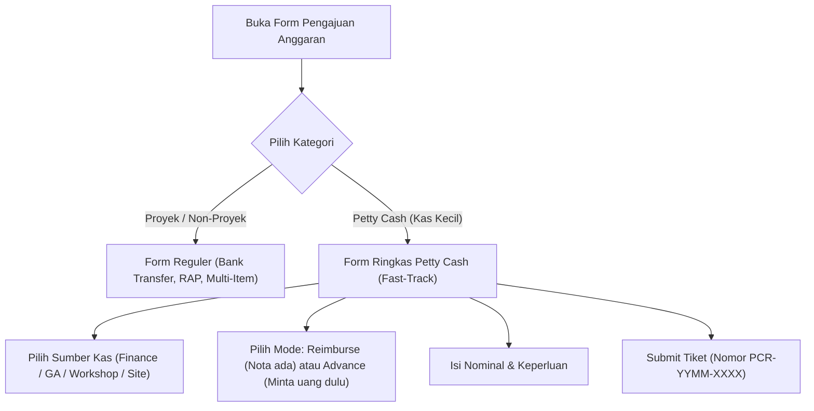
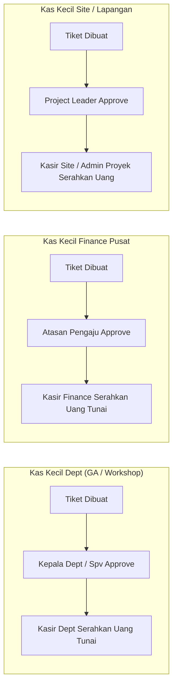
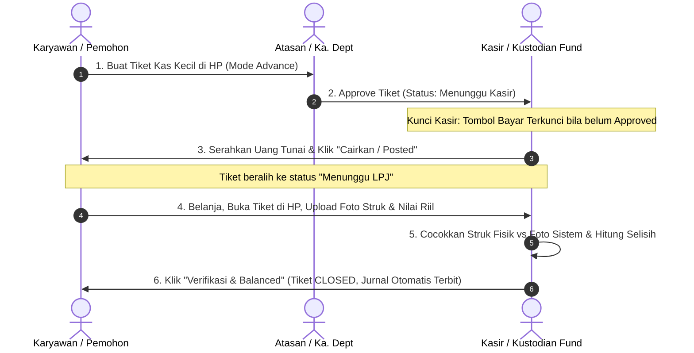
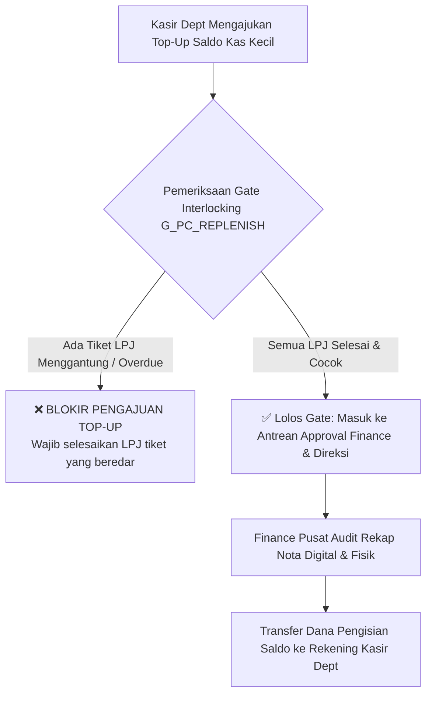

# Rencana Implementasi: Petty Cash Multi-Departemen dalam Pengajuan Anggaran (SOP "No Ticket, No Cash")

> **Dokumen Rencana Teknis & Desain Arsitektur Sistem**  
> *Target Aplikasi:* `erp-epi` (Admin/Finance Hub) & `project-epi` (Dashboard Lapangan / Mobile)  
> *Branch:* `Major`  
> *Stack:* SvelteKit + Directus + n8n  
> *Status:* Menunggu Konfirmasi & Persetujuan Pengguna Sebelum Eksekusi  

---

## 1. Latar Belakang & Prinsip Utama

Kebijakan **"No Ticket, No Cash" (Zero-Leakage Policy)** adalah standar tata kelola keuangan terbaik untuk menghentikan kebocoran kas kecil, hilangnya bukti nota, dan penumpukan kasbon gantung.

### Prinsip Pokok yang Diterapkan:
1. **Tidak Ada Uang Tunai Tanpa Tiket Sistem yang Approved:** Kasir / Pemegang Kas dilarang keras mengeluarkan uang sepeser pun sebelum ada nomor tiket pengajuan dengan status `Approved` di sistem. Ini memberikan perlindungan hukum bagi kasir saat dilakukan *cash opname* mendadak.
2. **Satu Pintu Pengajuan Anggaran (Unified Form):** Karyawan tidak perlu bingung memilih form berbeda. Form Pengajuan Anggaran kini mencakup 3 sumbu kategori:
   - 🏗️ **Proyek:** Melekat ke nomor proyek (`project_id`), pencairan via Transfer Bank / Kasbon Lapangan, approver: Project Leader → Manager → Finance.
   - 🏢 **Non-Proyek:** Melekat ke Departemen / Pos Kantor, pencairan via Transfer Bank ke Vendor / Payroll, approver: Kepala Divisi → Finance → Direksi.
   - 💵 **Petty Cash (Kas Kecil):** Melekat ke Kas Kecil Kasir / Fund Departemen (Uang Tunai), approver: **Atasan Langsung / Kepala Departemen → Kasir Pemegang Dana**.
3. **Multi-Fund Terdesentralisasi dengan Kontrol Terpusat:** Pengeluaran kas kecil operasional departemen (GA, Workshop, Lapangan) di-approve secara mandiri oleh Kepala Departemen masing-masing tanpa membebani Finance Pusat setiap hari. Namun, **Finance Pusat memegang kendali penuh saat pengisian ulang saldo (Replenishment)**.

---

## 2. Analisis Arsitektur & Rekomendasi Objektif

### Analisis Evaluatif:
Setelah meneliti codebase `erp-epi` dan `project-epi`:
- Di `erp-epi`, infrastruktur dasar petty cash sudah tersedia di `src/lib/components/finance/petty-cash/` dengan koleksi Directus `petty_cash_funds`, `petty_cash_requests`, `petty_cash_categories`, `petty_cash_category_rules`, dan `petty_cash_request_logs`.
- Di `project-epi`, rute `/ess/petty-cash` sudah ada untuk pengajuan terisolasi, namun **belum terintegrasi** dengan form utama `/anggaran/baru`.
- Form `/anggaran/baru` saat ini memiliki 1.600+ baris dengan validasi gate G1-G19, pemilihan rekening transfer bank, RAP, dan approval berjenjang Direktur.

### Rekomendasi Objektif (Arsitektur Terbaik):
> [!IMPORTANT]
> **Rekomendasi Arsitektur: "Satu Pintu UI, Mesin Terpisah yang Tersinkronisasi"**  
> Jangan menyatukan tabel database `petty_cash_requests` ke dalam tabel `pengajuan_anggaran`.  
> **Alasannya:**  
> 1. `pengajuan_anggaran` dirancang untuk transfer bank, multi-item belanja besar, verifikasi nomor rekening, dan persetujuan bertingkat Direksi.  
> 2. `petty_cash_requests` membutuhkan kecepatan (Fast-Track 30 detik), uang tunai instan di kasir lokal, siklus LPJ Advance/Reimburse, dan integrasi kustodian fisik.  
> 3. **Solusi Terbaik:** Jadikan Form Pengajuan Anggaran sebagai **Satu Pintu Visual (Unified Front-Door)**. Jika user memilih kategori *"Petty Cash"*, form otomatis beralih ke layout ringkas 3-4 input (Sumber Kas, Mode, Nominal, Keperluan, Lampiran). Di backend, data disimpan ke `petty_cash_requests` dan didaftarkan ke `master_pengajuan` (sehingga muncul di Pusat Pengajuan).  
> 4. Sementara itu, untuk **Isi Ulang Kas Kecil (Replenishment)**: Sepenuhnya menggunakan rute `pengajuan_anggaran` reguler dengan kategori `petty_cash_replenishment`, karena uang keluar dari Bank Finance Pusat ke Kasir Departemen dan memerlukan approval Direksi/Finance.

---

## 3. Struktur Multi-Fund Petty Cash

Di Directus (`petty_cash_funds`), telah dan akan dipastikan ketersediaan Fund untuk seluruh departemen operasional:

| Fund Code | Nama Fund | Departemen | Pemegang Kas (Kustodian) | Ceiling per Transaksi | Ambang Wajib Bukti |
| :--- | :--- | :--- | :--- | :--- | :--- |
| `PCF-FIN` | **Petty Cash Finance Pusat** | Finance / Umum | Kasir Finance | Rp 2.000.000 | > Rp 0 (Semua wajib) |
| `PCF-GA` | **Petty Cash GA & Operasional** | General Affairs | Staff GA (Pantry/Rumah Tangga) | Rp 1.000.000 | > Rp 50.000 |
| `PCF-WKS` | **Petty Cash Workshop** | Workshop / Bengkel | Admin Workshop (Ciketing/Balaraja)| Rp 1.500.000 | > Rp 50.000 |
| `PCF-SITE` | **Petty Cash Site Proyek** | Project / Lapangan | Admin Lapangan / Project Leader | Sesuai Plafon Mandiri Site | > Rp 0 (Semua wajib) |

*Catatan:* Konfigurasi limit, ceiling harian/bulanan, dan penanggung jawab kas dapat dikonfigurasi via UI Admin (`/finance?tab=petty-cash`) tanpa hardcode.

---

## 4. Alur Kerja (Workflow) End-to-End

### A. Alur Pengajuan Tiket (Fast-Track Form)

### B. Matriks Approval Berdasarkan Sumber Kas

### C. Siklus Pertanggungjawaban LPJ (SOP "No Ticket, No Cash")

### D. Kontrol Finance Pusat saat Pengisian Saldo (Replenishment Interlocking Gate)

---

## 5. Rekomendasi Terbaik Fitur Dashboard

Berikut rekomendasi fitur unggulan untuk menyempurnakan operasional di kedua sisi:

### A. Rekomendasi Dashboard Lapangan (`project-epi` / Mobile)
1. **Speedy Quick-Entry FAB (30-Detik Entry):**
   - Tambahkan pintasan cepat "Kas Kecil Cepat" pada floating action button lapangan.
   - Input hanya 3 field wajib: *Sumber Kas*, *Nominal*, *Keperluan*.
2. **Kamera Struk Anti-Crash & Auto-Compress:**
   - Proteksi tab crash Android via `formPersist` (IndexedDB untuk foto nota, SessionStorage untuk input).
   - Auto-kompresi gambar ke maksimal 1600px / < 1MB untuk hemat kuota dan unggah kilat di sinyal 3G lapangan.
3. **Indikator Sisa Plafon Fund Site (Live Gauge):**
   - Menampilkan sisa kas kecil proyek saat ini secara real-time agar Project Leader tahu kapan kas site perlu di-top-up.
4. **Slip Digital / E-Voucher Kasir:**
   - Setelah kasir menyerahkan uang, penerima dapat menandatangani digital sign di HP atau kasir generate e-struk sebagai bukti serah terima uang tunai.
5. **Dukungan Offline Outbox:**
   - Pengajuan kas kecil darurat di area blank-spot tersimpan di outbox lokal dan otomatis tersinkronisasi ketika ponsel kembali mendapat sinyal internet.

### B. Rekomendasi Dashboard Admin (`erp-epi` / Internal)
1. **Multi-Fund Petty Cash Radar (Cockpit Visual):**
   - Widget ringkasan 4 fund utama (Finance, GA, Workshop, Site) dalam 1 layar: Saldo saat ini, total terpakai bulan ini, dan jumlah tiket menunggu LPJ.
2. **LPJ Aging Tracker & Alerting (Radar Kasbon Gantung):**
   - Pengelompokan tiket Uang Muka berdasarkan umur: `0-3 Hari (Aman)`, `4-7 Hari (Peringatan)`, `>7 Hari (Menunggak / Kritis)`.
   - Otomatis trigger notifikasi WhatsApp via n8n ke karyawan dan atasannya jika H+7 belum upload struk.
3. **Audit Kepatuhan Cash Opname (Surprise Audit Wizard):**
   - Fitur bagi Internal Auditor / Finance Manager untuk melakukan cash opname mendadak: kasir diminta menghitung fisik uang di laci, sistem mencocokkan dengan `current_balance` sistem, dan membuat Berita Acara Selisih Kas (BASK) otomatis.
4. **Auto-COA & Expense Category Classifier:**
   - Rule engine pintar yang secara otomatis memetakan uraian belanja (misal: "beli bensin pickup", "fotokopi dokumen tender", "kabel roll") ke akun COA beban yang tepat, mengurangi beban kerja admin kasir.
5. **Replenishment Pack Generator (1-Klik Cetak Rekap LPJ):**
   - Saat kasir departemen ingin meminta top-up saldo ke Finance Pusat, kasir dapat mengklik "Generate Rekap Pengajuan Top-up". Sistem otomatis menghasilkan lembar rekap PDF beserta lampiran seluruh foto struk yang sudah diverifikasi.

---

## 6. Rencana Kerja Bertahap (Phased Rollout)

Untuk menjamin kehati-hatian, tidak merusak sistem yang sudah berjalan, dan bebas bug, pekerjaan dibagi ke dalam 5 fase terukur:

### Fase 1: Fondasi Master Data & Skema Multi-Fund (Backend & Directus)
- Pastikan konfigurasi `petty_cash_funds` untuk seluruh departemen (Finance, GA, Workshop, Site) lengkap dengan kustodian, ceiling, dan limit.
- Tambahkan relasi dan field pendukung: `source_channel`, `sumber_kas_fund_id`, status tracking LPJ.
- Siapkan gate enforcement: `G_PC_CEILING`, `G_PC_BUKTI`, `G_PC_LPJ`, dan `G_PC_REPLENISH_LOCK`.
- *Verifikasi:* Pengecekan endpoint API master fund dan rules via Directus REST.
- ❓ **Pertanyaan Kunci Akhir Fase 1:** *Apakah seluruh nama kasir/kustodian pemegang kas kecil untuk GA, Workshop, dan Site sudah terdaftar pada master Karyawan Directus?*

### Fase 2: Integrasi "Satu Pintu" di Form Pengajuan Anggaran Lapangan (`project-epi`)
- Modifikasi `/anggaran/baru`: Saat user memilih kategori "Kas Kecil (Petty Cash)", aktifkan sub-form ringkas Fast-Track (Pilih Sumber Kas, Nominal, Uraian, Mode Advance/Reimburse, Upload Nota).
- Tautkan dengan service `ajukanPettyCash` dan draft persistence di mobile.
- Perbarui halaman detail `/anggaran/[id]` untuk menampilkan badge status kas kecil, tracking kasir, dan tombol upload LPJ bagi tiket advance.
- *Verifikasi:* Pengujian submit pengajuan kas kecil dari HP (simulasi mobile) dan verifikasi data masuk ke Directus.
- ❓ **Pertanyaan Kunci Akhir Fase 2:** *Apakah pada dashboard lapangan, karyawan selain Project Leader (misal: mekanik/staff) boleh langsung membuat tiket petty cash ke kasir workshop/GA?*

### Fase 3: Integrasi Form Pengajuan Anggaran Admin (`erp-epi`) & Pusat Pengajuan
- Integrasikan sub-form Petty Cash pada `AjukanAnggaranModal.svelte` di admin.
- Integrasikan visibilitas tiket kas kecil di `pusat-pengajuan` (badge, tab, drawer detail lengkap dengan riwayat LPJ).
- Hubungkan drawer approval di `/pusat-pengajuan` dan `/approval` agar Kepala Departemen dapat langsung menyetujui tiket kas kecil departemennya.
- *Verifikasi:* Verifikasi approval Kepala Departemen via drawer approval admin.
- ❓ **Pertanyaan Kunci Akhir Fase 3:** *Apakah Kepala Departemen menyetujui pengajuan petty cash melalui Inbox Approval universal (`/approval`) atau melalui menu khusus kasir?*

### Fase 4: Alur Pencairan Kasir, Kunci Pengeluaran, & Penyelesaian LPJ
- Perkuat validasi di `/api/petty-cash-request/[id]/action`: Kasir dilarang posting sebelum status `approved`.
- Buat modal/antarmuka pencairan kasir yang mudah: Kasir input nominal riil uang yang diserahkan, status berubah jadi `posted` (menunggu LPJ).
- Buat antarmuka verifikasi LPJ: Kasir memeriksa foto struk vs nominal nota riil, input nominal selisih kas (jika ada), dan klik "Balanced".
- Otomatisasi jurnal akuntansi saat transaksi balanced.
- *Verifikasi:* Alur uang muka -> belanja -> upload struk -> verifikasi kasir -> balanced.
- ❓ **Pertanyaan Kunci Akhir Fase 4:** *Jika terdapat selisih uang muka (realisasi lebih kecil dari uang muka), apakah sisa uang langsung dikembalikan tunai ke kasir dan diverifikasi di tiket yang sama?*

### Fase 5: Fitur Replenishment Terkunci (Isi Ulang Saldo) & Otomasi n8n
- Buat form pengajuan Top-up Saldo Kas Kecil di `/finance?tab=petty-cash` yang mengarah ke kategori `petty_cash_replenishment` di Pengajuan Anggaran.
- Pasang **Interlocking Rule Gate G_PC_REPLENISH**: Blokir tombol submit pengisian saldo jika masih ada tiket pengeluaran di fund tersebut yang status LPJ-nya menunggak melewati 7 hari kerja.
- Siapkan skenario automasi n8n:
  - Notifikasi Telegram/WhatsApp/In-App ke Kepala Departemen saat tiket diajukan.
  - Notifikasi reminder H+3 dan H+6 ke karyawan yang memegang uang muka belum setor nota.
- *Verifikasi:* Uji coba penguncian pengajuan top-up saat ada tiket LPJ yang belum diselesaikan.
- ❓ **Pertanyaan Kunci Akhir Fase 5:** *Channel notifikasi mana yang ingin diprioritaskan untuk n8n (WhatsApp Business, Telegram Bot, atau Email internal)?*

---

## 7. Rencana Verifikasi & Uji Kelayakan

### Pengujian Teknis (Tanpa Browser Testing oleh Asisten):
1. **Pemeriksaan Kontrak API & Integritas Relasi:**
   - Validasi pemisahan relational fetching Directus (tidak ada nested fetch liar).
   - Validasi error handling (tidak ada 403 tak tertangani).
2. **Audit Keamanan Data & Autentikasi:**
   - Verifikasi bahwa kasir GA hanya bisa memproses tiket GA, kasir Workshop hanya memproses Workshop, dan kasir Site hanya memproses Site miliknya.
   - Verifikasi bahwa pemohon tidak bisa meng-approve tiketnya sendiri (anti-self-approval).
3. **Verifikasi Build & Syntax:**
   - Jalankan `npm run check` / TypeScript checker pada kedua repo untuk memastikan tidak ada type error atau broken component imports.

---

## 8. Panduan & Hint Pengguna (User Guidance)

Setiap tahapan form akan dilengkapi dengan panduan visual (`HelpTooltip` & `SectionGuide`):
- **Saat Pilih Sumber Kas:** *"Pilih Kasir tempat Anda akan mengambil uang tunai fisik. Pastikan memilih kasir departemen yang sesuai dengan lokasi kerja Anda."*
- **Saat Mode Advance (Uang Muka):** *"Gunakan mode Uang Muka jika belanja belum dilakukan. Anda wajib mengunggah foto kuitansi/nota fisik maksimal 7 hari kerja setelah uang diterima."*
- **Saat Mode Reimburse:** *"Gunakan mode Reimburse jika Anda sudah mengeluarkan uang pribadi terlebih dahulu. Foto nota asli wajib dilampirkan langsung saat pengajuan."*
- **Pesan Kunci Kasir:** *"Uang tunai belum boleh diserahkan. Tiket ini menunggu persetujuan atasan pemohon."*
- **Pesan Kunci Replenishment:** *"Pengisian saldo terkunci. Harap tuntaskan seluruh LPJ pengeluaran kas kecil yang masih berstatus terbuka."*
