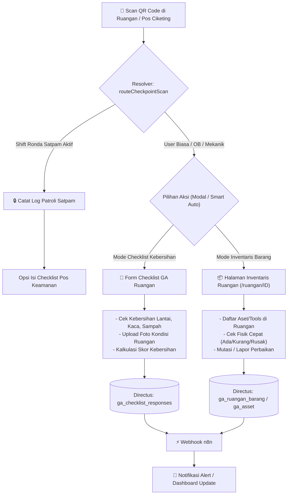

# Rencana Implementasi & Skema Arsitektur: General Affairs (GA) Terpadu WS Ciketing
**Lokasi Dokumen:** `docs/implementation_plan_General_Affair_Ciketing_Terpadu.md`  
**Target Branch:** `Major`  
**Stack:** SvelteKit, Directus, n8n (tanpa Supabase)  
**Konteks Aplikasi:**
- **Dashboard Admin:** `C:\dev\erp-epi\src\routes\ws-ciketing` (`internal.eltamaprimaindo.com`)
- **Dashboard Lapangan:** `C:\dev\project-epi\src\routes` (`project.eltamaprimaindo.com`)

---

## 1. Ringkasan Eksekutif & Prinsip Inti

Workshop Ciketing memerlukan tata kelola General Affairs (GA) yang lengkap seperti di kantor pusat (`/ga`), namun terfokus pada ekosistem operasional workshop Ciketing. 

### Prinsip Utama:
1. **Satu Barcode/QR Code untuk Dua Fungsi (Dual-Purpose QR):**
   Satu QR Code fisik ditempel di setiap ruangan/pintu Ciketing. Ketika discan, sistem secara cerdas melayani **Checklist Kebersihan GA** sekaligus **Cek & Sensus Inventaris Ruangan** (serta Checkpoint Patroli Satpam jika sedang shift ronda), tanpa perlu menempelkan banyak stiker barcode berbeda.
2. **Arsitektur Modular Anti-Monolit:**
   File `WsCiketing.svelte` saat ini berukuran >12.200 baris (668 KB). Seluruh fitur GA baru di admin akan diisolasi dalam sub-modul terpisah (`src/lib/components/finance/project/ciketing/ga/`) agar ringan, bebas risiko regresi, dan mudah di-maintain.
3. **Pemisahan Fetching Directus:**
   Mengikuti aturan ketat: query relasi Directus dipisah per entitas untuk mencegah error 403 / payload overload.
4. **Automasi Terpusat via n8n:**
   Notifikasi rekap harian, peringatan insiden/skor kebersihan rendah, dan alert patroli terlewat dikirim via webhook n8n ke WhatsApp/Telegram grup Ciketing.
5. **Eksekusi Bertahap (Fase demi Fase):**
   Setiap fase memiliki pengujian mandiri dan diakhiri dengan **satu pertanyaan kunci** konfirmasi sebelum melangkah ke fase berikutnya.

---

## 2. Skema Barcode Ganda: Inventory & Checklist GA

### Diagram Alur Scan Barcode Universal di Lapangan (`project-epi`):

### Logika Resolusi QR Code:
- Kode QR memuat identifier area: misal `CKT-R01` (Ruang Workshop Utama), `CKT-POS1` (Pos Satpam Ciketing), `CKT-GUDANG` (Gudang Consumable/Tools).
- Resolver memeriksa profil pengguna:
  - Jika **Satpam** dengan ronda aktif: langsung mencatat checkpoint patroli, lalu menampilkan checklist kebersihan pos.
  - Jika **OB / Petugas Kebersihan terjadwal**: langsung mengarahkan ke form checklist kebersihan ruangan tersebut.
  - Jika **Mekanik / Staff / Admin**: menampilkan dashboard ruangan yang memperlihatkan daftar inventaris/tools dengan tombol cepat *"Isi Checklist Kebersihan"* atau *"Cek Kondisi Inventaris"*.

---

## 3. Rencana Implementasi Bertahap (Fase 0 – Fase 5)

---

### FASE 0: Pondasi & Refactoring Sub-Navigasi GA Ciketing (Admin)

#### Tujuan:
Memecah tab `general_affair` di WS Ciketing yang saat ini hanya berupa satu tabel CRUD pengeluaran menjadi sub-navigasi hirarkis profesional tanpa membebani file induk.

#### Tindakan Kode:
1. **[NEW]** `src/lib/components/finance/project/ciketing/ga/WsCiketingGaModule.svelte`
   - Menampung sub-tab hirarkis:
     - `dashboard` (Ringkasan & Metrik GA Ciketing)
     - `patroli` (Monitoring Patroli Satpam Ciketing)
     - `checklist` (Hasil Checklist Kebersihan & Rekap Skor)
     - `inventaris` (Barang & Aset per Ruangan Ciketing)
     - `pengeluaran` (Existing: Catatan Pengeluaran & Kebutuhan GA)
     - `servicedesk` (Tiket Perbaikan & Permintaan GA)
2. **[MODIFY]** `src/lib/components/finance/project/WsCiketing.svelte`
   - Pindahkan logika flat-table GA lama ke dalam modul baru.
   - Panggil `<WsCiketingGaModule />` dengan lazy-loading dan properti proyek Ciketing.

#### Hint & Panduan:
- **Lokasi UI:** Admin Ciketing -> Tab Navigasi `Operasional & GA` (atau `WS Ciketing > GA`).
- **Hint:** Tab pengeluaran lama tidak hilang, melainkan menjadi sub-tab `Pengeluaran & Anggaran GA` agar data historis tetap aman.

> [!IMPORTANT]
> **Pertanyaan Kunci Fase 0:**  
> Apakah struktur sub-tab di atas (`Dashboard`, `Patroli`, `Checklist`, `Inventaris`, `Pengeluaran`, `Service Desk`) sudah sesuai dengan kebutuhan alur kerja harian di Ciketing?

---

### FASE 1: Integrasi Barcode Ganda & Checklist Kebersihan di Lapangan (`project-epi`)

#### Tujuan:
Menghubungkan scan barcode di area Ciketing agar petugas lapangan bisa melakukan checklist kebersihan dan sensus inventaris ruangan secara terintegrasi.

#### Tindakan Kode:
1. **[MODIFY]** `src/lib/utils/checkpointScanRoute.ts` di `project-epi`:
   - Tambahkan deteksi lokasi Ciketing berbasis prefix checkpoint atau atribut area.
   - Sediakan mode dialog cepat `"Pilih: Kebersihan atau Cek Barang"` jika scan dilakukan di luar sesi ronda khusus.
2. **[MODIFY]** `src/routes/(app)/ga-checklist/[id]/+page.svelte` & `src/routes/(app)/ruangan/[areaId]/+page.svelte`:
   - Hubungkan tautan silang: dari halaman checklist ada tombol *"Lihat Aset Ruangan Ini"*, dan dari halaman ruangan ada tombol *"Input Checklist Kebersihan"*.
3. **[NEW SERVICE]** `src/lib/services/ciketingGaApi.ts`:
   - Mengambil template checklist khusus Ciketing (misal: area bengkel las, area perakitan, area genset, mess karyawan Ciketing).

#### Hint & Panduan:
- **Panduan Penggunaan:** Petugas cukup membuka tombol kamera scan universal di navbar bawah `project-epi`, scan QR di pintu ruangan, dan pilih modul yang ingin diisi.
- **Offline Reliability:** Hasil scan dan checklist tersimpan di offline storage bila sinyal di workshop terputus, dan otomatis sync saat online.

> [!IMPORTANT]
> **Pertanyaan Kunci Fase 1:**  
> Apakah daftar ruangan/area di Ciketing sudah didaftarkan di Directus (`ga_area` / `ga_ruangan`), atau perlu kita sediakan template import data ruangan awal?

---

### FASE 2: Monitoring Patroli Satpam & Checklist Kebersihan di Admin (`erp-epi`)

#### Tujuan:
Admin dan Workshop Head Ciketing dapat memantau kedisiplinan ronda satpam dan skor kebersihan area workshop secara real-time.

#### Tindakan Kode:
1. **[NEW]** `src/lib/components/finance/project/ciketing/ga/subtabs/WsCiketingGaPatroliTab.svelte`:
   - Log sesi ronda satpam Ciketing (Jam mulai, jam selesai, checkpoint terlewati, foto bukti scan).
   - Indikator keterlambatan / pos yang terlewat.
2. **[NEW]** `src/lib/components/finance/project/ciketing/ga/subtabs/WsCiketingGaChecklistTab.svelte`:
   - Rekap harian kebersihan per ruangan (Heatmap warna: Hijau $\ge 90$, Kuning $\ge 70$, Merah $< 70$).
   - Galeri foto kondisi sebelum/sesudah dibersihkan.
   - Filter tanggal dan penanggung jawab (OB/Satpam).

#### Directus Query Policy:
- Query dipisahkan: `patrol_logs` difilter `location = 'ciketing'`, relasi `petugas` dan `scans` diambil secara bertahap (tidak nested query dalam yang rawan 403).

#### Hint & Panduan:
- **Lokasi UI:** Admin Ciketing -> GA -> Sub-tab `Patroli & Keamanan` dan `Kebersihan Ruangan`.
- **Indikator Visual:** Ruangan yang belum dicek hingga jam 10.00 pagi diberi badge merah berkedip sebagai peringatan.

> [!IMPORTANT]
> **Pertanyaan Kunci Fase 2:**  
> Berapa target frekuensi patroli satpam (misal: 3x sehari / tiap 2 jam pada malam hari) dan batas jam submit checklist kebersihan pagi yang ingin dijadikan standar evaluasi?

---

### FASE 3: Sensus Inventaris Ruangan & Preventive Maintenance (PM)

#### Tujuan:
Mengelola aset fisik dan peralatan pendukung GA di Ciketing (AC, genset, blower, APAR, dispenser, lampu workshop) yang terhubung ke barcode ruangan.

#### Tindakan Kode:
1. **[NEW]** `src/lib/components/finance/project/ciketing/ga/subtabs/WsCiketingGaInventarisTab.svelte`:
   - Daftar barang inventaris per ruangan di Ciketing.
   - Log mutasi barang (dipindah ke ruangan lain atau diperbaiki).
2. **[NEW]** `src/lib/components/finance/project/ciketing/ga/subtabs/WsCiketingGaPmTab.svelte`:
   - Jadwal pemeliharaan berkala fasilitas (servis berkala AC, uji coba genset mingguan, masa berlaku isi APAR).
   - Kalender dan status jatuh tempo (Normal, Mendekati Jatuh Tempo, Terlambat).

#### Hint & Panduan:
- **Panduan:** Saat teknisi/petugas melakukan servis AC di Ciketing, mereka tinggal scan QR di ruangan, pilih aset AC, dan update tanggal servis berikutnya.

> [!IMPORTANT]
> **Pertanyaan Kunci Fase 3:**  
> Apakah pemeliharaan alat/mesin produksi workshop (seperti mesin las, kompresor) masuk ke dalam tab GA ini, atau tetap terpisah di modul Maintenance Mesin Ciketing?

---

### FASE 4: Service Desk GA & Alur Automasi n8n

#### Tujuan:
Menampung komplain atau permintaan dari mekanik/karyawan lapangan Ciketing (misal: lampu mati, kran bocor, request sabun/sarung tangan) dan mengirimkan peringatan otomatis.

#### Tindakan Kode:
1. **[NEW]** `src/lib/components/finance/project/ciketing/ga/subtabs/WsCiketingGaServiceDeskTab.svelte`:
   - Kanban board status: `Menunggu Review` -> `Dikerjakan` -> `Selesai` -> `Ditolak`.
   - Estimasi biaya perbaikan dan PIC pelaksana.
2. **[AUTOMATION]** Integrasi Webhook n8n:
   - Event 1: *Temuan Kritis* (APAR kedaluwarsa, insiden keamanan, skor kebersihan < 60) -> Webhook n8n -> Kirim Notifikasi WA ke Leader Workshop.
   - Event 2: *Laporan Rekap Harian* -> Cron n8n setiap pukul 18.00 WIB -> Rangkuman persentase checklist dan patroli hari itu.

#### Hint & Panduan:
- **Objektif:** Menghindari hardcode nomor WA atau konfigurasi bot di SvelteKit; semua webhook URL disimpan di `.env` dan logika routing pesan dikelola di canvas n8n.

> [!IMPORTANT]
> **Pertanyaan Kunci Fase 4:**  
> Siapa saja (nomor WhatsApp / role penerima) yang wajib menerima notifikasi alert otomatis ketika ada temuan kritis di Ciketing?

---

### FASE 5: Dashboard Konsolidasi, Rekap Bulanan & Validasi Akhir

#### Tujuan:
Menyediakan executive overview untuk Workshop Manager dan GA Management pusat mengenai kondisi workshop Ciketing secara keseluruhan.

#### Tindakan Kode:
1. **[NEW]** `src/lib/components/finance/project/ciketing/ga/subtabs/WsCiketingGaDashboardTab.svelte`:
   - Kartu KPI: Tingkat Kepatuhan Patroli (%), Rata-rata Skor Kebersihan (0-100), Total Pengeluaran GA Bulan Ini (Rp), Tiket Service Desk Terbuka.
   - Grafik tren pengeluaran vs anggaran bulanan GA Ciketing.
2. **[EXPORT]** Cetak Laporan Bulanan GA Ciketing (Format Cetak / PDF).

#### Hint & Panduan:
- Dashboard ini memberikan evaluasi instan tanpa harus membuka puluhan baris data mentah.

> [!IMPORTANT]
> **Pertanyaan Kunci Fase 5:**  
> Apakah format laporan bulanan GA Ciketing memerlukan format approval bertanda tangan digital (Project Leader & General Affairs Manager)?

---

## 4. Rekomendasi Fitur Terbaik (Nilai Tambah Nyata)

### A. Rekomendasi untuk Dashboard Admin (`erp-epi`):
1. **Live Checkpoint Tracker:** Peta denah interaktif Ciketing dengan indikator titik hijau (sudah discan hari ini) dan titik merah (belum discan).
2. **Cost-to-Area Attribution:** Setiap pengeluaran GA (pembelian sapu, cat, lampu) langsung dialokasikan ke ruangan/area spesifik di Ciketing, sehingga ketahuan area mana yang paling boros biaya perawatan.
3. **SLA Monitoring Tiket Perbaikan:** Penghitungan jam sejak tiket diajukan hingga perbaikan tuntas (membantu evaluasi kecepatan tim GA).
4. **Verifikasi Foto Anti-Curang:** Validasi watermark tanggal dan jam otomatis pada foto checklist kebersihan untuk mencegah pengunggahan foto lama dari galeri.

### B. Rekomendasi untuk Dashboard Lapangan (`project-epi`):
1. **Mode Offline Super Ringan:** Petugas bisa melakukan scan di area bunker/gudang Ciketing yang minim sinyal; data tersimpan di IndexedDB dan tersinkronisasi otomatis begitu mendapat koneksi.
2. **One-Tap Quick Incident Report:** Tombol cepat darurat bagi satpam jika ada insiden di workshop (kebocoran, korsleting, tamu tak dikenal) langsung dengan kamera instan dan GPS tag.
3. **Daftar Checklist Dinamis Sesuai Karakter Ruangan:** Checklist ruang genset berbeda dengan checklist ruang kantor atau toilet Ciketing (tidak dipukul rata).

---

## 5. Ringkasan Pertanyaan untuk Konfirmasi

Sebelum melangkah ke eksekusi kode:
1. **Persetujuan Arsitektur:** Apakah disetujui pemisahan modul GA Ciketing ke dalam folder modular `src/lib/components/finance/project/ciketing/ga/` untuk menjaga performa?
2. **Prioritas Alur Barcode:** Apakah alur barcode ganda (scan 1 QR untuk checklist kebersihan + cek barang inventaris) sudah sesuai dengan skenario lapangan?
3. **Daftar Ruangan Awal:** Berapa perkiraan jumlah pos/ruangan di Ciketing yang akan dipasangi QR code pada tahap awal?
