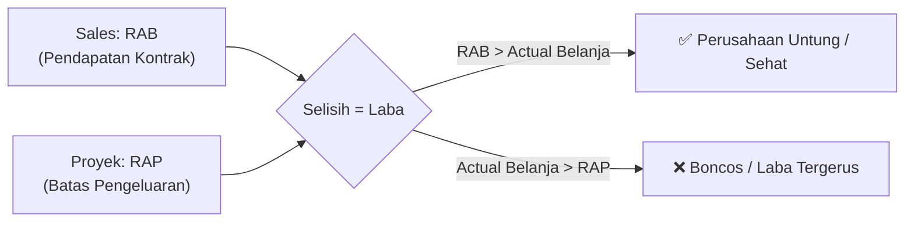

# Panduan Praktis: Perbedaan RAB vs RAP & Hubungannya
> **Panduan Bahasa Awam untuk Rekan-Rekan Sales, Project Leader, Mekanik, dan Estimator**

---

## 1. Pengantar: Kenapa Istilah Ini Sering Bikin Bingung?

Di dunia industri dan proyek, sering kali terdengar obrolan:
- *Sales:* "RAB proyek ini Rp 150 juta, sudah deal sama klien!"
- *Tim Proyek:* "Loh, tapi dana yang boleh saya belanjakan di lapangan kenapa cuma Rp 100 juta di sistem?"
- *Finance:* "Jangan sampai pengeluaran lapangan melebihi RAP ya!"

Keduanya sama-sama berawalan **"Rencana Anggaran"**, tetapi **tujuan, pemilik dokumen, dan angka di dalamnya sangat berbeda**.

---

## 2. Definisi Sederhana (Bahasa Manusiawi)

### A. RAB (Rencana Anggaran Biaya) — Dokumen Milik Sales & Klien
> **"Berapa harga yang kita ajukan dan tagihkan ke Klien."**

* **Siapa yang mengurus:** Tim Sales, Estimator, Tender/Marketing.
* **Untuk siapa:** Klien / Pemberi Kerja / Customer.
* **Kapan dibuat:** Di awal, saat proses tender, proposal penawaran (*Quotation*), sebelum kontrak atau SPK/PO terbit.
* **Isi dokumen:**
  * Estimasi biaya riil pekerjaan
  * **+ Keuntungan / Margin Perusahaan**
  * **+ Biaya Risiko / Kontingensi**
  * **+ Pajak (PPN/PPh)**
* **Sifat:** **Dokumen Eksternal / Komersial**. Ini adalah **Harga Jual (Revenue)** yang disepakati dengan pelanggan.

---

### B. RAP (Rencana Anggaran Pelaksanaan) — Pegangan Tim Proyek & Lapangan
> **"Berapa modal maksimal yang boleh dihabiskan untuk menyelesaikan pekerjaan di lapangan."**

* **Siapa yang mengurus:** Project Manager, Project Leader, Engineering, dibantu Finance & Procurement.
* **Untuk siapa:** Internal Perusahaan (Tim Lapangan, Mekanik, Logistik, Akuntansi).
* **Kapan dibuat:** Setelah proyek *deal* (PO/SO resmi masuk), sebelum pekerjaan fisik lapangan dimulai.
* **Isi dokumen:**
  * Biaya material / sparepart riil (harga nett negosiasi dengan supplier)
  * Upah tenaga kerja, uang saku, lembur teknisi/mekanik
  * Sewa alat kerja / armada / operasional workshop
  * Perlengkapan K3 (APD), consumable, bahan habis pakai
  * Transportasi, akomodasi, dan konsumsi lapangan
  * **TIDAK ADA angka profit perusahaan di dalam RAP!**
* **Sifat:** **Dokumen Internal & Rahasia**. Ini adalah **Plafon Biaya Pokok (HPP / Modal Bersih)**.

---

## 3. Analogi Sehari-Hari: "Bisnis Katering Nasi Kotak"

Supaya makin mudah dibayangkan, bayangkan perusahaan kita membuka pesanan **Nasi Kotak**:

```
+-----------------------------------------------------------------------+
|  1. SALES membuat Penawaran ke Pembeli (RAB)                          |
|     Harga jual ke pembeli: Rp 45.000 / kotak                          |
|     (Sudah termasuk laba katering, sewa ruko, dan pajak)              |
+-----------------------------------------------------------------------+
                                  |
                                  v
+-----------------------------------------------------------------------+
|  2. PEMBELI SETUJU (Deal / PO Diterbitkan)                            |
+-----------------------------------------------------------------------+
                                  |
                                  v
+-----------------------------------------------------------------------+
|  3. KOKI & BELANJA PASAR membuat Batas Modal (RAP)                    |
|     Batas belanja dapur: MAKSIMAL Rp 28.000 / kotak                   |
|     (Beras Rp 5.000, Ayam Rp 12.000, Sayur Rp 4.000, Kotak Rp 3.000, |
|      Gas & Tenaga Rp 4.000)                                           |
+-----------------------------------------------------------------------+
                                  |
                                  v
+-----------------------------------------------------------------------+
|  HASIL AKHIR:                                                         |
|  * Pembeli bayar: Rp 45.000                                           |
|  * Koki belanja:  Rp 28.000                                           |
|  -----------------------------------------------------------------    |
|  * Untung Bersih: Rp 17.000 (Target Laba Perusahaan)                  |
+-----------------------------------------------------------------------+
```

* Kalau Koki belanja boros ke pasar sampai menghabiskan **Rp 40.000/kotak**, untung katering langsung amblas, meskipun pembeli tetap bayar lunas Rp 45.000.
* Kalau Koki bisa belanja cerdas dan rapi hanya menghabiskan **Rp 25.000/kotak**, katering untung makin besar (**Rp 20.000/kotak**).

---

## 4. Tabel Perbandingan Head-to-Head

| Pembeda | RAB (Rencana Anggaran Biaya) | RAP (Rencana Anggaran Pelaksanaan) |
| :--- | :--- | :--- |
| **Fokus Utama** | Harga Jual (*Selling Price*) | Modal Belanja Lapangan (*Cost of Good Sold / HPP*) |
| **Audiens Utama** | Klien / Customer / Owner Proyek | Tim Lapangan, Project Leader, Finance, Direksi |
| **Status Dokumen** | Eksternal (Boleh dilihat klien) | Internal Rahasia (Klien **tidak boleh** lihat) |
| **Unsur Margin Laba** | **ADA** (Termasuk target laba & overhead) | **TIDAK ADA** (Hanya modal riil belanja) |
| **Penentu Angka** | Harga pasar, strategi negosiasi, margin target | Harga aktual vendor, metode kerja efisien di lapangan |
| **Di Sistem ERP** | Mengunci Nilai Kontrak / PO / Penagihan (Invoicing) | Mengunci Plafon Pengajuan Kasbon, PR, & Belanja Material |
| **Jika Terjadi Selisih** | Klien menawar $\rightarrow$ Margin berkurang | Lapangan belanja lebih $\rightarrow$ Perusahaan terancam rugi |

---

## 5. Lalu, Apa Hubungan Antara RAB dan RAP?

Hubungan keduanya sangat erat, bagaikan **dua sisi dari satu koin**:



### 1. Hubungan Rumus Finansial (Laba Perusahaan)
$$\text{Target Laba Perusahaan} = \text{Total RAB (Nilai Jual)} - \text{Total RAP (Modal Riil)}$$

* **RAB adalah batas atas penerimaan kas (Uang Masuk)**.
* **RAP adalah batas atas pengeluaran kas (Uang Keluar)**.

### 2. Hubungan Estafet Kerja
* **Sales tidak boleh asal tembak harga di RAB**: Jika Sales menjual terlalu murah tanpa bertanya ke tim teknis/lapangan, maka RAP yang dibuat tidak akan cukup untuk membeli material dan membayar teknisi.
* **Proyek wajib berpedoman pada komitmen RAB**: Proyek tidak boleh membeli barang di luar item pekerjaan yang dijanjikan Sales ke klien tanpa proses adendum/klaim pekerjaan tambah (*variation order*).

### 3. Hubungan Kontrol di Sistem ERP & Project Lapangan
Di sistem `erp-epi` dan `project-epi`:
* Saat mekanik atau Project Leader mengajukan Kasbon atau Pengajuan Anggaran di aplikasi lapangan, sistem akan memeriksa:
  > *"Apakah pos belanja ini ada di dalam RAP? Dan apakah sisa kuota RAP untuk kategori ini masih cukup?"*
* Jika pengajuan melebihi plafon RAP, sistem akan mengunci (*gate block*) dan membutuhkan persetujuan khusus direksi/manajemen karena pengeluaran tersebut berpotensi memotong keuntungan perusahaan.

---

## 6. Simulasi Angka Nyata (Contoh Proyek Rp 100 Juta)

Katakanlah PT EPI mendapatkan pekerjaan Overhaul & Fabrikasi Unit:

### A. RAB (Diserahkan Sales ke Klien)
* Jasa Overhaul & Rekondisi: Rp 45.000.000
* Material & Sparepart Pengganti: Rp 40.000.000
* Mobilisasi & Alat Bantu: Rp 15.000.000
* **Total Tagihan ke Klien (RAB): Rp 100.000.000** *(belum PPN)*

### B. RAP (Diberikan Manajemen ke Project Leader Lapangan)
Manajemen menetapkan target margin 30% (Laba Rp 30.000.000).  
Maka, total RAP yang diberikan ke lapangan adalah **Rp 70.000.000**:
* Jasa Tukang & Teknisi Lapangan: Rp 26.000.000
* Pembelian Sparepart & Material: Rp 32.000.000
* Sewa Alat, Transport & Safety (APD): Rp 9.000.000
* Biaya Operasional & Cadangan Tak Terduga: Rp 3.000.000
* **Plafon Maksimal Belanja Lapangan (RAP): Rp 70.000.000**

### C. Apa yang Terjadi Saat Eksekusi?
1. **Skenario Ideal:** Tim lapangan belanja total Rp 68.000.000. Perusahaan untung Rp 32.000.000 (sukses & hemat).
2. **Skenario Boncos:** Tim lapangan sering beli part darurat dan lembur tak terkontrol hingga menghabiskan Rp 85.000.000. Keuntungan perusahaan yang tadinya diharapkan Rp 30 juta langsung terpangkas sisa Rp 15 juta saja.

---

## 7. Catatan Emas untuk Tim Sales & Tim Proyek

### 🤝 Untuk Rekan-Rekan Sales:
1. **Jangan banting harga RAB tanpa cek realita lapangan:** Memberi diskon besar ke klien memang mempermudah *closing*, tapi kalau nilai RAB lebih kecil dari kebutuhan riil RAP, proyek itu hakikatnya proyek nombok.
2. **Detailkan spesifikasi di RAB:** Semakin jelas merk sparepart, kapasitas, dan batas pekerjaan yang tertulis di penawaran, semakin aman tim proyek dari tuntutan klien yang meminta hal di luar kesepakatan.

### 🛠️ Untuk Rekan-Rekan Proyek / Lapangan:
1. **RAP adalah pagar pembatas, bukan uang jajan bebas:** Setiap nota, kuitansi, atau pengajuan belanja harus dicocokkan dengan pos akun di RAP.
2. **Jika klien minta pekerjaan tambahan:** Jangan langsung dikerjakan sebelum terbit **RAB Tambahan (Adendum/VO)**. Jika dikerjakan tanpa adendum, biaya belanja lapangan naik (melebihi RAP), tapi uang masuk dari klien tidak bertambah!

---

## 8. Ringkasan Singkat (Cheatsheet)

* **RAB** = Rencana Anggaran Biaya $\rightarrow$ **Harga Jual ke Klien (Uang Masuk)** $\rightarrow$ Dibuat Sales.
* **RAP** = Rencana Anggaran Pelaksanaan $\rightarrow$ **Batas Belanja di Lapangan (Uang Keluar)** $\rightarrow$ Dijalankan Tim Proyek.
* **RAB dikurangi RAP** = **Laba Perusahaan**.
