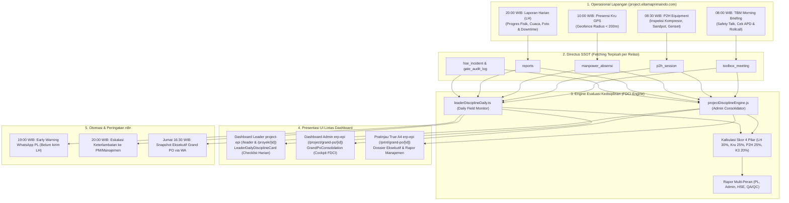
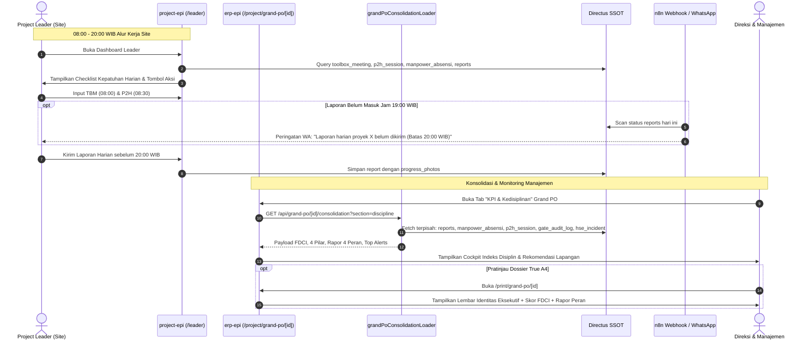

# Peta Alur Bisnis & Arsitektur: KPI Manajemen Proyek & Indeks Kedisiplinan Lapangan (FDCI)

*Dokumentasi Resmi Sistem Informasi PT ELTAMA PRIMA INDO (SI-TAMA)*  
*Revisi Terakhir:* 09 November 2026  
*Status:* Terverifikasi & Terintegrasi Lintas Dashboard (Admin `erp-epi` & Lapangan `project-epi`)  

---

## 1. Ikhtisar & Tujuan Bisnis

Sistem **KPI Manajemen Proyek & Indeks Kedisiplinan Lapangan (Field Discipline & Compliance Index - FDCI)** dirancang untuk menutup celah antara pengawasan manajemen di kantor pusat (*office*) dengan realitas operasional di lapangan (*site*). Sistem ini menghubungkan seluruh data riil dari **Directus (Single Source of Truth)** secara terpisah per relasi, tanpa manipulasi dan tanpa angka karangan, untuk mengevaluasi kedisiplinan dan kepatuhan operasional pada 3 tingkatan:

1. **Tingkat Eksekutif & Direksi (`erp-epi` → `/print/grand-po/[id]` & `/project/grand-po/[id]`):**
   - Indeks Kedisiplinan Lapangan (FDCI 0–100) dengan predikat *Sangat Tertib (≥90)*, *Disiplin Baik (75–89)*, *Perlu Perbaikan (50–74)*, dan *Kritis (<50)*.
   - Rapor Evaluasi 4 Peran Manajemen Proyek: *Project Leader, Admin Proyek, HSE Officer, QA/QC Inspector*.
   - Filter persona pandangan (*Lens Selector*): Mode Semua Persona, Mode Disiplin Lapangan, dan Mode Manajemen Risiko.
   - Integrasi snapshot n8n otomatis ke WhatsApp Direksi dan Manajemen.

2. **Tingkat Tim Kantor Pusat / Admin (`erp-epi` → `GrandPoConsolidation.svelte`):**
   - Cockpit terpadu konsolidasi paket PO pada tab `KPI & Kedisiplinan`.
   - Analisis mendalam 4 Pilar Kedisiplinan:
     1. Laporan Harian (Realisasi hari kerja wajib, ketepatan waktu sebelum 20:00 WIB, rasio foto fisik).
     2. Presensi Kru (Total kehadiran mandays, rasio tepat waktu, kepatuhan geofence GPS).
     3. P2H Equipment (Sesi checklist harian alat, status GO laik vs No-Go rusak).
     4. K3 & Lifecycle Gate (Insiden LTI/Nearmiss, sesi TBM morning, audit override gerbang).
   - Tombol pengaturan gerbang lifecycle `/settings/gates` dan `/pengajuan/kalibrasi-gate` untuk Superadmin.

3. **Tingkat Lapangan / Mandor / Project Leader (`project-epi` → `/leader` & `/proyek/[project_id]`):**
   - Kartu checklist harian interaktif (`LeaderDailyDisciplineCard.svelte`):
     - **08:00 WIB:** Sesi TBM Morning Briefing (Safety Talk & APD kru).
     - **08:30 WIB:** Pemeriksaan P2H Equipment (Kompresor, Sandpot, Genset).
     - **10:00 WIB:** Presensi Kru Lapangan (Check-in dalam geofence).
     - **20:00 WIB:** Laporan Harian Proyek (Input progres fisik, cuaca, downtime & foto).
   - Panduan praktis jam kritis operasional (*operasional expandable hint*).
   - Tombol tindakan cepat (*1-click action*) menuju modul input terkait.

---

## 2. Diagram Alur Bisnis Utama (Mermaid Flowchart)

---

## 3. Diagram Interaksi Antar-Sistem (Sequence Diagram)

---

## 4. Matriks 4 Pilar & Formula Pembobotan Indeks FDCI

Indeks Kedisiplinan Lapangan (*Field Discipline & Compliance Index* - FDCI) dihitung menggunakan skala 0 hingga 100 dengan pembobotan objektif:

| Pilar | Bobot | Indikator Penilaian | Target Standar Eltama |
| :--- | :---: | :--- | :--- |
| **1. Laporan Harian (LH)** | **30%** | • Rasio hari lapor vs hari kerja wajib (Senin–Sabtu). • Ketepatan waktu input (Tepat Waktu: jam kirim < 20:00 WIB). • Kelengkapan foto progres & area kerja fisik. | Minimal 90% hari kerja terlapor tepat waktu & berfoto fisik lengkap. |
| **2. Presensi Kru Lapangan** | **25%** | • Rasio kehadiran kru vs kuota yang ditugaskan. • Tingkat keterlambatan (*punctuality rate*). • Validitas geofence GPS (radius < 200m dari koordinat proyek). | Kehadiran ≥ 85%, geofence valid ≥ 90%, nol absensi liar. |
| **3. P2H Equipment Site** | **25%** | • Kelengkapan sesi checklist harian alat sebelum mesin menyala. • Rasio unit kondisi GO (laik) vs No-Go. • Work order perbaikan diterbitkan bila ada No-Go. | 100% equipment aktif diperiksa sebelum 08:30 WIB; nol alat No-Go dioperasikan. |
| **4. K3 & Gate Lifecycle** | **20%** | • Nol insiden kritis / *Lost Time Injury* (LTI). • Keterlaksanaan sesi *Toolbox Meeting* (TBM) pagi. • Kepatuhan gerbang tanpa *bypass* atau *override* liar. | Zero accident, TBM 100% terlaksana setiap pagi sebelum 08:30 WIB. |

---

## 5. Rapor Evaluasi 4 Peran Manajemen Proyek

Sistem secara otomatis menghitung rapor kinerja peran manajemen proyek secara individual untuk mencegah lempar tanggung jawab:

1. **Project Leader (PL):**
   - *Komposisi Nilai:* 30% SLA Laporan Harian + 30% K3/TBM + 20% P2H Alat + 20% Kepatuhan Lifecycle Gate.
   - *Indikator Keberhasilan:* Site tertib administrasi, laporan harian konsisten sebelum 20:00 WIB, zero accident, alat terawat.

2. **Admin Proyek:**
   - *Komposisi Nilai:* 40% Kelengkapan SPK/Surat Tugas + 35% Kecepatan Rekap Laporan + 25% Berkas Logistik Surat Jalan.
   - *Indikator Keberhasilan:* Personil lapangan bertugas dengan dasar SPK resmi, tidak ada berkas tanda terima yang tercecer.

3. **HSE / Safety Officer:**
   - *Komposisi Nilai:* 50% Zero Incident / LTI + 30% Konsistensi TBM Briefing + 20% Kepatuhan APD Kru.
   - *Indikator Keberhasilan:* Lingkungan kerja aman, briefing bahaya kerja terlaksana setiap pagi, APD lengkap.

4. **QA/QC Inspector:**
   - *Komposisi Nilai:* 40% DFT Coating Pass Rate (Aturan 85/15) + 35% Kondisi Lingkungan (ΔT ≥ +3°C, RH ≤ 85%) + 25% ITP Signoff.
   - *Indikator Keberhasilan:* Pengecatan memenuhi spesifikasi teknis klien, ketebalan cat seragam, bebas cacat aplikasi.

---

## 6. Integrasi Lifecycle Gate & Konfigurasi Superadmin

Seluruh gerbang tata kelola kedisiplinan dan pelaporan proyek terdaftar dalam arsitektur lifecycle dan dapat dikonfigurasikan modenya (`shadow`, `warn`, `soft`, `hard`) oleh Superadmin melalui UI `/settings/gates`:

| Kunci Gate | Deskripsi Bisnis | Perilaku Saat Gagal | Cara Kalibrasi via UI |
| :--- | :--- | :--- | :--- |
| **`G_PKL_LAPORAN_HARIAN`** | Memeriksa kepatuhan pengiriman laporan harian proyek. Menahan pengajuan bila laporan bolong > 2 hari. | *HARD:* Menahan pengajuan anggaran/material. *WARN:* Muncul peringatan di dashboard. | Buka `/settings/gates` → Pilih jenis `PL` → Atur mode dan masa tenggang jam (*grace hour*). |
| **`G_PKL_EQUIPMENT_P2H`** | Memeriksa pelaksanaan checklist P2H harian pada alat berat yang ditugaskan ke site. | *HARD:* Menahan mobilisasi & pemakaian alat. *WARN:* Memberi peringatan ke mekanik & PL. | Buka `/settings/gates` → Atur ambang batas equipment wajib P2H. |
| **`G_DOSSIER_PRINT_AUDIT`** | Memverifikasi kelengkapan metrik komersial, QC, HSE, dan kedisiplinan sebelum dossier dicetak resmi. | *STRICT:* Cetak ditahan atau diberi watermark **DRAFT**. *PASSED:* Dokumen resmi siap terbit. | Buka `/pengajuan/kalibrasi-gate` → Pilih modul Dossier Grand PO. |

---

## 7. Otomasi n8n & Kanal Notifikasi WhatsApp

1. **Jadwal Teratur n8n:**
   - **Pukul 19:00 WIB (Senin–Sabtu):** *Early Warning Check*. n8n memeriksa seluruh proyek aktif yang belum memiliki record di `reports` hari itu, lalu mengirimkan pesan peringatan ramah ke grup WA Project Leader terkait.
   - **Pukul 20:15 WIB (Senin–Sabtu):** *Overdue Escalation*. n8n memicu notifikasi eskalasi ke Project Manager dan Manajemen Operasional bila proyek belum melaporkan progres fisik harian.
   - **Jumat 16:30 WIB:** *Weekly Grand PO Dossier Digest*. Mengirim ringkasan eksekutif komprehensif (Progres Fisik, Payroll, QC DFT, K3, dan Skor Disiplin FDCI) ke Direksi.

2. **Format Pesan WhatsApp Resmi:**
   Setiap pesan otomatis yang dikirimkan melalui integrasi n8n menampilkan data riil dari Directus SSOT tanpa nilai rekaan:
   - Identitas Proyek & Lokasi
   - Progres Fisik (%) & Deviasi Kurva S
   - Presensi Kru & Mandays
   - Hasil Uji QC (Lingkungan & DFT)
   - Status Keselamatan K3 / Zero Accident
   - Skor Indeks Kedisiplinan Lapangan (FDCI 0–100)
   - Tautan langsung ke Dokumen Dossier Resmi
