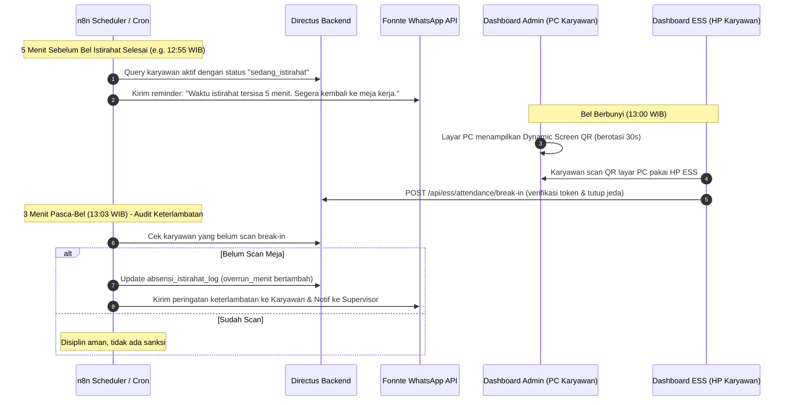

# Rencana Implementasi: Absensi Setelah Istirahat Berbasis Barcode / Dynamic QR (Admin & Lapangan)

- **Target Implementasi:**
  - **Dashboard Admin (Internal):** `C:\dev\erp-epi\src\routes` (`internal.eltamaprimaindo.com`)
  - **Dashboard Lapangan / ESS:** `C:\dev\project-epi\src\routes` (`project.eltamaprimaindo.com`)
  - **Backend & Database:** Directus Engine (`https://directus.eltamaprimaindo.com`)
  - **Automasi & Notifikasi:** n8n Workflow (`https://n8n.internal.eltamaprimaindo.com`)
- **Dokumen Referensi:** `setup-absensi-istirahat-fase0.js`, `SCOPE-deteksi-alpa-missing-day.md`, `PanelKonfigurasiDisiplin.svelte`.

---

## 1. Analisis Konteks & Evaluasi Objektif

### 1.1 Masalah Operasional Riil
- Karyawan (khususnya admin meja seperti sales, finance, dan logistik) sering terlambat kembali ke meja kerja setelah bel istirahat berbunyi (masih makan, mengobrol, atau memperpanjang waktu ibadah).
- Manajemen membutuhkan kepastian kehadiran fisik bahwa saat bel/waktu istirahat selesai, karyawan **benar-benar sudah berada di meja kerjanya** (atau di area kerjanya).

### 1.2 Kritik Objektif Terhadap Sistem Barcode Statis (Wajib Diperhatikan)
> [!WARNING]
> **Kelemahan Fatal Barcode/QR Statis Fisik Ditempel di Meja:**
> 1. **Titip Foto Barcode (WhatsApp Abuse):** Karyawan dapat memotret barcode mejanya sekali, menyimpannya di galeri HP, lalu mengirimkannya ke teman atau memindainya langsung dari layar HP kedua saat masih berada di kantin atau musholla.
> 2. **Scan Teman Sekantor (Titip Absen):** Teman di meja sebelah bisa dengan mudah memindai barcode meja rekannya yang belum kembali.
> 3. **Kerusakan Fisik & Kotor:** Stiker barcode kertas/laminasi di meja cepat kotor, memudar, tergores kopi/debu, atau sobek.

### 1.3 Rekomendasi Solusi Objektif & Alternatif Terbaik
Untuk mengatasi kelemahan di atas demi kepentingan operasional dan akurasi aplikasi, kami merekomendasikan **3 Model Verifikasi yang Terpadu**:

```
[ Model A: Karyawan Meja/PC (Sales/Finance/Admin) ]
  → Layar PC menampilkan DYNAMIC SCREEN QR (berotasi tiap 30 detik TOTP).
  → Karyawan scan layar PC kerjanya menggunakan HP (project-epi).
  → BUKTI SAH: Karyawan wajib ada di depan monitor komputer yang sedang aktif/unlocked. Foto statis via WA otomatis GAGAL karena token hangus dalam 30 detik.

[ Model B: Karyawan Lapangan/Produksi/Workshop (Tanpa PC Meja) ]
  → Barcode Meja/Station + Geofence GPS + Selfie Liveness (sudah didukung kamera project-epi).
  → Atau Kiosk Tablet di pintu masuk area kerja / workshop yang menampilkan QR berganti.

[ Model C: Automasi n8n (Early Warning & Disiplin Bel) ]
  → H-5 Menit Bel: n8n kirim WA blast ke karyawan yang statusnya masih istirahat.
  → Bel Berbunyi: Perhitungan toleransi dimulai (misal 3 menit).
  → Lewat Toleransi: n8n mendeteksi belum scan -> catat keterlambatan istirahat & eskalasi SP/Teguran.
```

---

## 2. Arsitektur Data Directus (Sesuai Aturan: Separated Fetch & No 403)

Directus sudah memiliki dasar skema istirahat dari Fase 0 (`istirahat_kategori`, `absensi_istirahat_log`, dan field konfigurasi di `konfigurasi_kebijakan_disiplin`). Kita memperluas dengan modul meja/station tanpa menambah koleksi berlebihan:

### 2.1 Koleksi Master Meja / Workstation (`master_workstation`)
Untuk memetakan meja kerja fisik dengan karyawan atau departemen:
- `id` (UUID, Primary Key)
- `kode_meja` (String, e.g. `DSK-SLS-01`, `DSK-ACC-02`, `STN-WKS-01`)
- `nama_lokasi` (String, e.g. "Meja Sales 1 - Lantai 2", "Station Bubut Workshop")
- `departemen_id` (M2O ke `departments`, di-fetch terpisah)
- `karyawan_id` (M2O ke `karyawan`, karyawan penanggung jawab meja, di-fetch terpisah)
- `tipe_verifikasi` (Dropdown: `dynamic_screen_pc`, `static_qr_desk`, `kiosk_station`)
- `secret_key` (String, hash/salt rahasia untuk validasi signature QR dinamis)
- `lokasi_absensi_id` (M2O ke `lokasi_absensi`, koordinat kantor/workshop)
- `is_active` (Boolean, default true)

### 2.2 Penambahan Field di `absensi_istirahat_log`
- `workstation_id` (M2O ke `master_workstation`)
- `metode_scan` (String: `screen_dynamic_qr`, `desk_static_qr`, `kiosk_scan`)
- `scan_token_hash` (String, mencegah token scan ganda)
- `scan_timestamp` (Timestamp saat scan terverifikasi)

### 2.3 Penambahan Field Konfigurasi di `konfigurasi_kebijakan_disiplin`
Semua parameter dapat diatur via Admin UI tanpa deploy kode:
- `istirahat_metode_wajib` (Dropdown: `bebas`, `dynamic_qr_screen`, `barcode_meja_static`, `hybrid`)
- `istirahat_qr_rotasi_detik` (Integer, default `30` detik)
- `istirahat_toleransi_bel_menit` (Integer, default `3` menit setelah bel istirahat selesai)
- `istirahat_peringatan_h_minus_menit` (Integer, default `5` menit sebelum bel untuk reminder WA via n8n)
- `istirahat_wajib_pc_login` (Boolean, default `true` untuk karyawan admin)

> [!IMPORTANT]
> **Aturan Directus**: Setiap query ke `absensi_istirahat_log`, `master_workstation`, dan `karyawan` WAJIB menggunakan fetching terpisah untuk menghindari error 403 atau error relasi kompleks Directus.

---

## 3. Fitur Dashboard Admin & Dashboard Lapangan

### 3.1 Dashboard Admin (`C:\dev\erp-epi` → `internal.eltamaprimaindo.com`)
1. **Layar Presence Meja (Presence Screen QR Modal / Widget)**:
   - Ditaruh di header atau sidebar dashboard internal.
   - Saat mendekati jam bel masuk istirahat (misal jam 12:55 - 13:10), banner/modal "Verifikasi Meja Kerja" muncul atau dapat dibuka karyawan di PC-nya.
   - Menampilkan QR dinamis yang dihitung dari: `HMAC(kode_meja + karyawan_id + timestamp_slot, secret_key)`.
   - Menggunakan pure JS / SVG canvas tanpa library berat.
2. **Tab Monitoring Kehadiran Pasca-Istirahat di HRD Absensi (`HrdAbsensi.svelte`)**:
   - Sub-tampilan baru: "Monitoring Istirahat Hari Ini".
   - Menampilkan live status:
     - Hijau: Sudah kembali ke meja tepat waktu (dengan info jam scan & meja).
     - Kuning: Sedang berjalan (dalam jendela toleransi).
     - Merah: Terlambat / Belum scan setelah bel + toleransi berakhir.
   - Tombol manual override jika ada karyawan yang PC-nya mendadak mati / lampu padam.
3. **Menu Manajemen Meja & Cetak QR Stiker**:
   - CRUD data meja kerja dan penempatan karyawan.
   - Fitur "Cetak Label QR Meja" (format standar EPI: `EPI:DSK:<id>:<signature>`) untuk stiker fisik di meja bagi workstation non-PC.
4. **Panel Pengaturan Disiplin**:
   - Tab khusus di `PanelKonfigurasiDisiplin.svelte` untuk menyetel durasi istirahat, toleransi bel, dan status aktivasi.

### 3.2 Dashboard Lapangan / ESS (`C:\dev\project-epi` → `project.eltamaprimaindo.com`)
1. **Pemindai Kamera Terintegrasi di Tombol "Absen Setelah Istirahat"**:
   - Saat karyawan mengklik `Kembali dari Istirahat` (`mode=break-in`), sistem otomatis membuka pemindai kamera (menggunakan komponen `QrCameraScanner.svelte` yang sudah teruji berbasis `html5-qrcode`).
   - Kamera langsung mengarah ke QR di layar PC atau meja kerja.
2. **Validasi Instan & Feedback User**:
   - Getaran haptic + suara "beep" sukses saat QR terbaca.
   - Menampilkan konfirmasi: *"Terverifikasi di Meja: DSK-SLS-01 (Sales 1) - Tepat Waktu"*.
   - Jika QR tidak cocok dengan meja penugasan: *"Peringatan: Anda memindai meja orang lain (DSK-ACC-03). Pastikan memindai meja Anda sendiri."* (bisa diatur strict atau toleran).
3. **Dukungan Offline Queue**:
   - Mengintegrasikan antrean `offlineAttendanceQueue.ts` agar scan tetap tersimpan aman jika jaringan Wi-Fi/seluler mendadak terputus saat scan.

---

## 4. Alur Integrasi Automasi n8n (Semua Automasi Wajib via n8n)



---

## 5. Rencana Tahapan Eksekusi (Fase Bertahap)

Sesuai aturan kerja bertahap dan kehati-hatian, rencana dibagi menjadi 4 Fase. **Di setiap akhir fase ada satu pertanyaan kunci sebelum lanjut ke fase berikutnya:**

### **Fase 1: Skema Directus, Master Meja Kerja & Generator Barcode (Admin)**
- Membuat koleksi `master_workstation` dan relasi terkait di Directus via skrip migrasi.
- Menambahkan konfigurasi barcode istirahat di `konfigurasi_kebijakan_disiplin`.
- Membuat UI manajemen meja kerja dan cetak label QR di Dashboard Admin (`erp-epi`).
- Menambahkan generator kode standar EPI (`EPI:DSK:<id>:<secret>`).
- *Pertanyaan Kunci Fase 1:*
  > **"Apakah satu meja kerja harus terkunci 1-ke-1 untuk satu karyawan tertentu saja, atau boleh bersifat floating/fleksibel (bisa dipakai bergantian oleh beberapa staf divisi yang sama)?"**

### **Fase 2: Dynamic Screen QR (Admin PC) & Scanner Break-In ESS (HP Lapangan)**
- Menambahkan komponen widget Dynamic Screen QR di Dashboard Admin (`erp-epi`) dengan rotasi TOTP 30 detik.
- Mengintegrasikan pemindai kamera (`QrCameraScanner.svelte`) ke halaman `break-in` di `project-epi`.
- Mengimplementasikan endpoint verifikasi token QR di `/api/ess/attendance/break-in` dengan validasi waktu dan anti-replay hash.
- *Pertanyaan Kunci Fase 2:*
  > **"Bila seorang karyawan meja PC-nya sedang mati/rusak atau sedang bertugas keluar ruangan, apakah diperbolehkan memindai stiker QR cadangan dengan swafoto (selfie), atau wajib meminta persetujuan manual ke supervisor?"**

### **Fase 3: Live Dashboard Monitoring HRD & Rekap Disiplin Real-Time**
- Menambahkan tab monitoring visual di `HrdAbsensi.svelte` (grid status kehadiran meja pasca-istirahat).
- Filter status: Tepat Waktu, Toleransi, Terlambat, Belum Kembali.
- Integrasi ke mesin hitung sanksi `istirahatOverrunEngine.js` (Teguran Lisan, Tertulis, SP).
- *Pertanyaan Kunci Fase 3:*
  > **"Berapa menit toleransi keterlambatan setelah bel yang Anda kehendaki sebelum karyawan otomatis tercatat kena potongan/teguran disiplin (rekomendasi: 3 atau 5 menit)?"**

### **Fase 4: Alur Automasi n8n & Notifikasi WhatsApp (Early Warning & Rekap)**
- Membangun workflow n8n untuk Reminder H-5 Menit via Fonnte WA.
- Membangun workflow n8n untuk Deteksi Keterlambatan Pasca-Toleransi.
- Membangun workflow laporan rekap harian ke HRD/Manajer terkait kepatuhan istirahat per divisi.
- *Pertanyaan Kunci Fase 4:*
  > **"Apakah notifikasi keterlambatan langsung dikirimkan ke nomor WhatsApp pribadi karyawan yang bersangkutan sebagai peringatan otomatis, atau hanya dilaporkan ke grup Supervisor/HRD terlebih dahulu?"**

---

## 6. Panduan & Hint Penggunaan UI (User Friendly)

### 6.1 Hint untuk Karyawan (Tampil di Aplikasi Mobile ESS):
- **Saat Istirahat:**
  > *"Pilih jenis istirahat (Makan Siang / Sholat) dan klik 'Mulai Istirahat'. Anda akan menerima pengingat via WhatsApp 5 menit sebelum bel berbunyi."*
- **Saat Selesai Istirahat:**
  > *"Buka dashboard komputer kerja Anda, lalu gunakan kamera HP ini untuk memindai kode QR yang muncul di layar monitor. Pastikan posisi Anda sudah siap di meja sebelum memindai."*

### 6.2 Panduan untuk HRD & IT (Tampil di Dashboard Admin):
- **Pengaturan Meja:** Masukkan nomor meja sesuai denah ruangan kantor. Karyawan yang login di PC tersebut otomatis menampilkan QR untuk meja tersebut.
- **Toleransi Bel:** Dapat diatur fleksibel di *Menu HRD > Konfigurasi Kebijakan Disiplin > Tab Istirahat*.

---

## 7. Rekomendasi Fitur Tambahan Terbaik (Value Added)

1. **Auto Screen Lock / Screensaver QR di PC Meja:**
   Saat jam istirahat dimulai, dashboard internal di PC karyawan otomatis beralih ke mode fullscreen standby yang memajang countdown jam masuk & QR scan. Karyawan tidak perlu login ulang rumit, cukup scan QR di layar untuk membuka dashboard kerjanya kembali.
2. **Kategori Sholat Fleksibel (Tanpa Kuota Berlebihan):**
   Memastikan kategori 'Sholat' memiliki jatah waktu terpisah (misal 15-20 menit per jadwal waktu sholat dzuhur/ashar) agar ibadah tetap terfasilitasi dengan baik tanpa mengorbankan kedisiplinan jam kerja.
3. **Sound Bell / Web Audio Sync di Dashboard:**
   Dashboard internal di PC kantor memutar audio bel pendek lembut saat jam 13:00 tepat sebagai pengingat audio di ruangan kantor.
